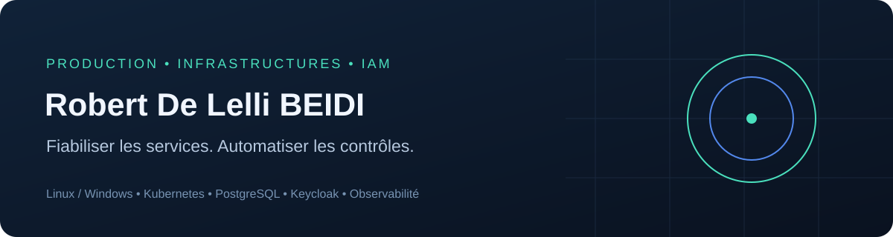

# Production IT, infrastructures et automatisation



**Collection professionnelle de Robert De Lelli BEIDI**

Scripts, requêtes SQL, diagnostics, dashboards et procédures pour l'exploitation
de plateformes d'entreprise. La collection rassemble neuf projets autonomes,
avec leurs exemples, tests, documentation et indications de provenance.

**9 projets techniques · 58 thèmes documentés · 25 fichiers SQL · 4 dashboards**

[Profil professionnel](https://github.com/MonsieurFara) · [Catalogue complet](docs/PROJECTS.md) · [Origine des contenus](PROVENANCE.md) · [Validation](VALIDATION.md)

La [reprise du 12 octobre](docs/RECOVERY-20261012.md) ajoute un source HTML APS
retrouvé, sa variante de fermeture, un générateur de manifests ConfigMap et
Deployment, un guide Java/TLS et des correctifs de validation. L'[inventaire
SHA-256](docs/FILE-INVENTORY.sha256) permet de vérifier les fichiers publiés.

## Explorer les projets

| Projet | Contenu |
|---|---|
| [Exploitation et automatisation](projects/production-ops-toolkit) | Outils de diagnostic Linux, HTTP/TLS, collecte et recherche de traces. |
| [PostgreSQL et SQL](projects/postgresql-operations) | Diagnostic, sauvegardes, réplication logique et préparation de migration PostgreSQL 16/17. |
| [Kubernetes et conteneurs](projects/kubernetes-runbooks) | Diagnostics de pods, mémoire, réseau et registres ; manifests de laboratoire. |
| [Alfresco ACS / APS](projects/alfresco-workflow-ops) | Diagnostic de cohérence documentaire, Solr/CMIS et suivi de workflows Activiti. |
| [IAM, SSO et cybersécurité](projects/iam-sso-operations) | Audit Active Directory, Keycloak/LDAP, contrôles Liferay/Casbin et exercices KQL. |
| [Supervision et KPI](projects/observability-dashboards) | Dashboards Grafana/Vega, règles Prometheus et calculs de KPI sur données synthétiques. |
| [Continuité et stockage](projects/continuity-storage-runbooks) | Sauvegardes, intégrité, S3/MinIO/NAS et scénarios PCA/PRA. |
| [Mises en production et documentation](projects/delivery-change-management) | Préchecks, gestion du changement, validation de release, dossiers de recette et guides. |
| [Organigramme et données annuaire](projects/org-directory-reconciliation) | Scripts retrouvés et adaptés ; préparation et rapprochement RH/AD avec données synthétiques. |

Chaque dossier possède son README, ses procédures, ses scripts et ses exemples.
Les exemples publics ont été adaptés ou reconstruits à partir des travaux
retrouvés ; les scripts historiques récupérés sont identifiés dans leur projet.
Les données de démonstration sont synthétiques.

## Voir une démonstration


- [Dashboards Grafana et Vega](projects/observability-dashboards/dashboards)
- [Dashboard HTML autonome](projects/observability-dashboards/examples/demo-dashboard.html) : télécharger le fichier et l'ouvrir dans un navigateur.
- [CSV de démonstration et KPI calculés](projects/observability-dashboards/examples)
- [Scénario PostgreSQL local](projects/observability-dashboards/lab)

## Utiliser la collection

```bash
git clone https://github.com/MonsieurFara/production-ops-toolkit.git
cd production-ops-toolkit
python3 tools/validate_collection.py
python3 tools/inventory.py --check
```

Pour utiliser un outil, consulter le README de son projet et se placer dans
`projects/<nom-du-projet>`. Les prérequis varient : Python, Bash, Node.js,
PowerShell avec le module Active Directory, ou un laboratoire dédié.

Le workflow GitHub Actions exécute les tests fonctionnels des projets et les
contrôles de syntaxe Bash, Python, JavaScript et JSON, puis vérifie l'inventaire
des fichiers. Les résultats et limites de la reprise sont consignés dans
[VALIDATION.md](VALIDATION.md). Les opérations sur des plateformes réelles et
les imports de dashboards restent à vérifier dans un laboratoire.

## Travaux documentés et projets en cours

Le [catalogue](docs/PROJECTS.md) couvre aussi les incidents, changements,
diagnostics et contributions dont la restitution publique prend la forme de
procédures. Il distingue source retrouvée, adaptation et reconstruction.

Les projets de moteur de batchs comptables, plateforme de workflows indépendante
et portfolio animé sont décrits dans la [feuille de route](docs/ROADMAP.md) avec
leur état réel. Les [anciens projets de développement](docs/HISTORICAL_REPOSITORIES.md)
restent référencés sur GitHub.

## Contribution et sécurité

Consulter [CONTRIBUTING.md](CONTRIBUTING.md) et [SECURITY.md](SECURITY.md).
Conserver les exports, journaux et secrets hors du dépôt. Les procédures
présentent leurs limites et les contrôles nécessaires avant toute intervention.

Les logiciels cités appartiennent à leurs auteurs. Aucune licence de
redistribution générale n'est accordée ; l'auteur pourra choisir une licence
ultérieurement.
