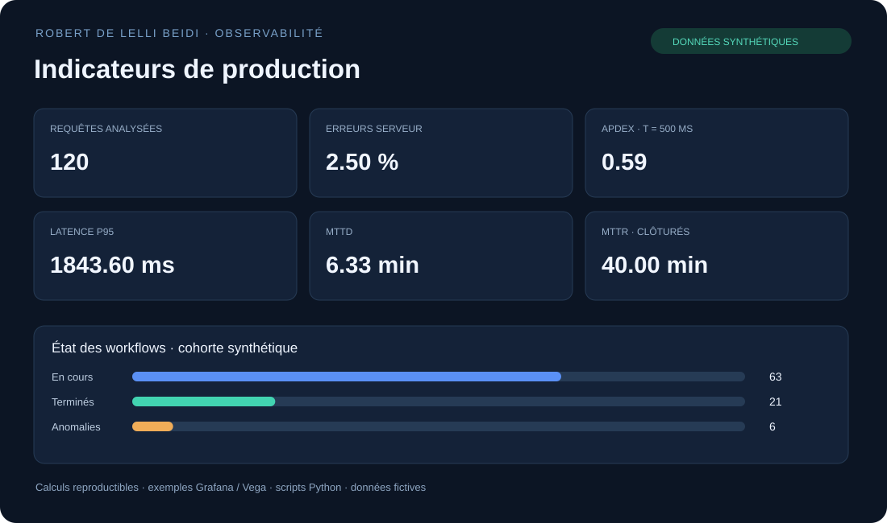

> Projet de la [collection technique](../../README.md). Exécuter les commandes de ce guide depuis ce dossier. La validation continue est pilotée par le workflow à la racine de la collection.

# Observability Dashboards



Dashboards importables et calculs reproductibles sur données synthétiques.
Les fichiers publics sont de nouveaux exemples ; ils ne sont pas des exports
de dashboards de production.

## Démarrer hors ligne

```bash
python3 scripts/calculate_kpis.py --traffic examples/traffic.csv --incidents examples/incidents.csv \
  --workflows examples/workflows.csv --dataset-label synthetic-demo --output artifacts/kpis.json
python3 scripts/render_report.py --input artifacts/kpis.json --output artifacts/dashboard.html
python3 -m unittest discover -s tests -v
```

| Livrable | Dépendances / usage |
|---|---|
| `dashboards/grafana/system-overview.json` | Import Grafana ; source Prometheus + node_exporter à sélectionner |
| `dashboards/grafana/workflow-overview.json` | Import Grafana ; source PostgreSQL et schéma synthétique ops_demo |
| `dashboards/vega/cpu.json`, `memory.json` | Coller le JSON dans une visualisation Vega de Kibana |
| `alerts/prometheus.rules.yml` | Exemples de règles, seuils à calibrer et vérifier avec promtool |
| `lab/` | Schéma et données fictives pour les requêtes de workflow |
| `examples/demo-dashboard.html` | Aperçu autonome à données synthétiques, ouvrable sans service |

Vega suit le **Time Picker du dashboard** ; la requête ne fixe pas une plage
`now-15m`. Choisir un index Metricbeat et vérifier les champs normalisés.

Le taux d'erreurs et l'Apdex sont calculés à partir du trafic échantillonné.
La clôture des workflows est un état de la cohorte, distinct d'une disponibilité
ou d'un taux de résolution d'incidents. [Définitions des KPI](docs/kpi-definitions.md).

## Validation

Tests sur limites Apdex, erreurs, cohorte vide, doublons et chronologie des
incidents ; JSON et YAML contrôlés localement. Import Grafana/Kibana,
requêtes PostgreSQL et promtool restent à exécuter dans un laboratoire.
